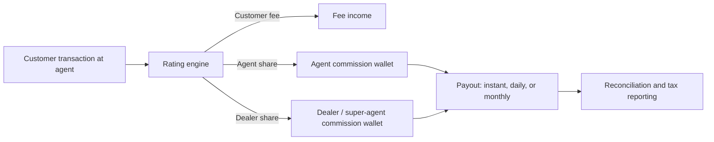

# Mobile Money Agent Commission

An educational guide to **agent commission on a mobile money platform**: how agents and their dealers or super-agents are paid for cash-in, cash-out, registration, and bill payment, how commission is calculated and settled, and how to design a structure that keeps the network healthy without inviting gaming. Written for operators and fintechs evaluating platforms in the [EVD System](https://evdsystem.com/) and [MoboGage](https://evdsystem.com/about-mobogage/) family.

---

## What Is Mobile Money Agent Commission?

**Agent commission** is the payment a mobile money operator makes to the shops, kiosks, and individuals who serve customers on its behalf. Agents handle the physical side of mobile money: turning cash into e-money (cash-in), e-money into cash (cash-out), registering new customers, and helping with payments.

Commission is how agents earn a living from that work. It also pays the layer above them, often called a **super-agent**, **master agent**, or **dealer**, who recruits agents, manages their float, and supervises them.

Get the structure right and agents keep float on hand and serve customers well. Get it wrong and you see split transactions, fake registrations, and agents who refuse cash-outs.

---

## How Commission Flows

### Core components

| Component | Responsibility |
|-----------|----------------|
| **Commission plans** | Rules per transaction type, amount band, channel, and agent tier |
| **Rating engine** | Calculates fee and commission split at transaction time |
| **Hierarchy model** | Knows which dealer each agent belongs to, and the dealer's share |
| **Commission wallet / ledger** | Holds earned but unpaid commission, separate from float |
| **Payout scheduler** | Pays commission instantly, daily, or at month end |
| **Clawback rules** | Reverses commission on reversed, fraudulent, or non-qualifying transactions |
| **Reporting** | Statements for agents and dealers, and tax or withholding reports |

---

## Common Commission Models

| Model | How it works | Watch out for |
|-------|--------------|---------------|
| **Flat per transaction** | Fixed amount per cash-in or cash-out | Encourages splitting one large transaction into several small ones |
| **Percentage of value** | A share of the transaction amount | Agents may push large values only; needs caps |
| **Tiered bands** | Different commission per amount band | Bands must align with customer fee bands to avoid arbitrage |
| **Fee share** | Agent gets a share of the fee the customer paid | Simple to explain; zero-fee products need a separate rule |
| **Registration bounty** | One-off payment per new customer, often paid after first activity | Fake or dormant registrations if paid on sign-up alone |
| **Volume or performance bonus** | Extra payment for hitting targets | Targets that are too high get gamed; too low cost money for nothing |

Most operators combine two or three of these. Cash-in commission is often lower than cash-out, because cash-out is the service customers value most and the one agents are most tempted to refuse when float is short.

See [docs/commission-checklist.md](./docs/commission-checklist.md) for a design and review checklist.

---

## Design Considerations

- **Keep commission separate from float.** Agents need to see what they earned versus the e-money they use to serve customers. Mixing the two hides liquidity problems.
- **Pay on qualifying activity.** Registration bounties paid after a first real transaction cut down fake sign-ups.
- **Detect splitting.** Repeated transactions between the same customer and agent within minutes, each just under a band boundary, are a classic pattern.
- **Make the dealer share explicit.** Agents trust a structure they can see. Show agent and dealer shares on statements.
- **Clawback must be automatic.** If a transaction is reversed, its commission should reverse too, on the same ledger.
- **Withholding tax.** Many markets require tax on agent commission; build it into the payout, not a spreadsheet afterwards.
- **Change control.** Commission plan edits move real money. Use maker-checker approval and effective dates.

MoboGage's EVD System platform covers merchant and agency channels, commission handling, and distributor credit through CreditSync, so agent, merchant, and reseller payouts can run on the same rules engine.

---

## FAQ

**What is agent commission in mobile money?**
The payment an operator makes to agents, and usually their dealers, for cash-in, cash-out, registrations, and other services carried out on its behalf.

**Why is cash-out commission often higher than cash-in?**
Cash-out needs the agent to hold physical cash and is the service customers rely on most. Higher commission encourages agents to keep enough cash to serve them.

**How often should agents be paid?**
It varies. Instant or daily payout helps small agents with cash flow; monthly payout is easier to audit. Many operators pay per transaction into a commission wallet and allow withdrawal at any time.

**How do you stop commission fraud?**
Pay registration bonuses only after real activity, detect transaction splitting, reverse commission automatically on reversals, and review outlier agents regularly.

**How does this relate to MoboGage / EVD System?**
MoboGage provides mobile money, merchant and agency channels, and distributor credit tools within EVD System. See [merchant and agency onboarding, commissions and QR](https://evdsystem.com/evd-software/merchant-agency-onboarding-commissions-qr/) and [about MoboGage](https://evdsystem.com/about-mobogage/).

---

## Glossary (short)

- **Super-agent / dealer** — the business that recruits and supervises agents and earns a share of their commission
- **Float** — the e-money and cash an agent holds to serve customers
- **Commission wallet** — a ledger account holding commission earned but not yet withdrawn
- **Clawback** — reversing commission already credited
- **Transaction splitting** — breaking one transaction into several to earn more commission

---

## Further Reading / Related Industry Resources

- [Merchant and agency onboarding, commissions and QR](https://evdsystem.com/evd-software/merchant-agency-onboarding-commissions-qr/) — MoboGage merchant and agency channels
- [CreditSync: distributor and agent credit operations](https://evdsystem.com/evd-software/creditsync-distributor-agent-credit-operations/) — credit and settlement for distributors and agents
- Related repo: [mobile-money-agent-network](https://github.com/iwtglobal/mobile-money-agent-network) — building and managing a mobile money agent network

---

## License

Documentation in this repository is provided under the MIT License. See [LICENSE](./LICENSE).

*Educational material only. Not legal, tax, regulatory, or financial advice. MoboGage and EVD System refer to offerings on evdsystem.com.*
